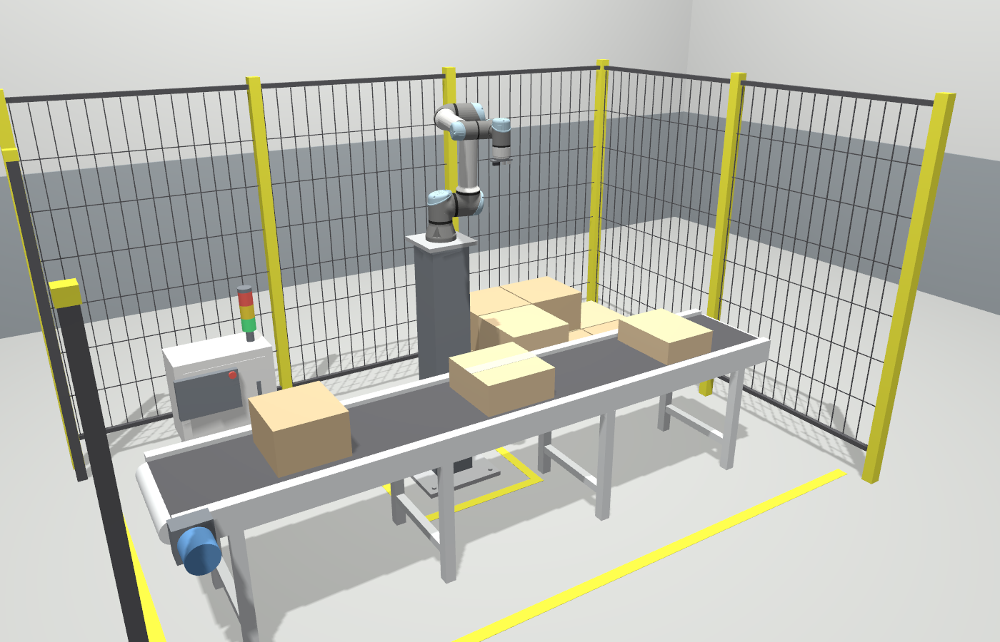
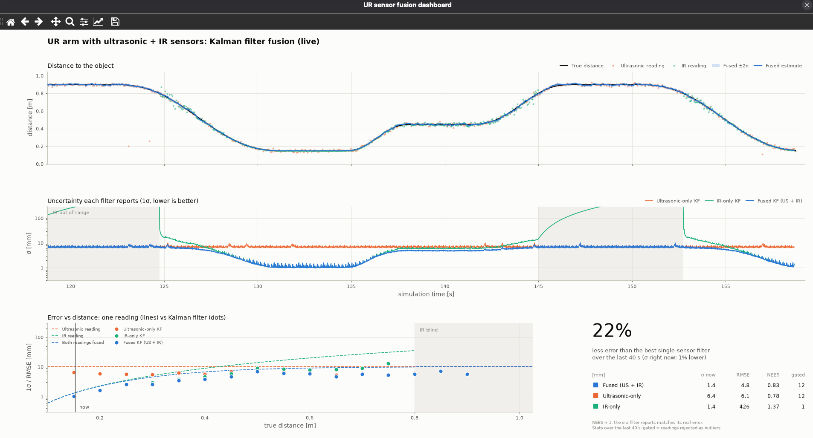
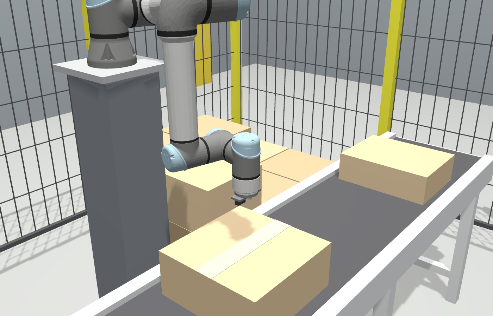
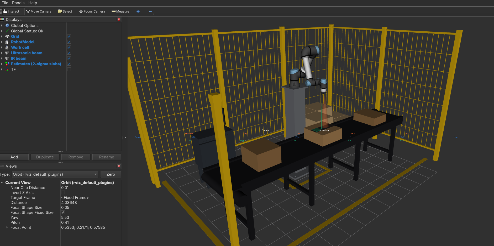
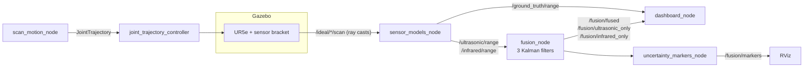

# UR5e proximity sensing: ultrasonic + IR fusion with a Kalman filter

A small ROS 2 + Gazebo project that shows, with live numbers, why fusing two
imperfect sensors gives a better distance estimate than either one alone.

A UR5e on a steel riser, inside a guarded work cell, carries a bracket with two
range sensors that look straight down at a part waiting on a belt conveyor. The
arm sweeps the sensors from 0.90 m down to 0.15 m above the part and back, the
way a robot might measure a part before picking it. Three Kalman filters
estimate the distance at the same time:

| filter            | uses                    |
|-------------------|-------------------------|
| `ultrasonic_only` | the ultrasonic sonar    |
| `infrared_only`   | the IR triangulation sensor |
| `fused`           | both                    |

All three filters share the same motion model and the same noise models, so any
difference between them comes only from the data each one receives. A live
dashboard and RViz show how much smaller the fused uncertainty is.



*The work cell in Gazebo: belt conveyor with the part, robot on its riser, pallet
station, control cabinet with stack light, mesh guarding, light curtain and
floor tape.*



*The live dashboard during a Gazebo run. The fused filter (blue) has the lowest σ
everywhere. It matches the IR sensor up close, beats both sensors at mid range,
and keeps working where the IR sensor is blind (shaded).*

### Results from the Gazebo simulation

1σ uncertainty each filter reports, while the arm dwells at each distance:

| distance | ultrasonic-only | IR-only | **fused** |
|---|---|---|---|
| 0.15 m (IR's best range) | 6.4 mm | 1.0–1.2 mm | **1.0–1.2 mm** |
| 0.45 m (sensors about equal) | 6.5 mm | 6.0 mm | **4.7 mm** |
| 0.90 m (IR out of range) | 6.4 mm | blind, grows to > 400 mm | **6.4 mm** |

Over a 40 s window (about 1.5 sweeps), the fused estimate's RMSE against ground
truth is 5.0–5.4 mm, against 6.4–6.8 mm for the best single-sensor filter: about
20–25 % less error. NEES stays between 0.8 and 1.0, so every filter's reported σ
matches its real error.

## Quick start

Tested on Ubuntu 26.04 with ROS 2 Lyrical and Gazebo (gz sim 10). It needs
`ur_description`, `ros_gz`, `gz_ros2_control` and `ros2_controllers`:

```bash
sudo apt install ros-lyrical-ur-description ros-lyrical-ros-gz ros-lyrical-gz-ros2-control ros-lyrical-ros2-controllers ros-lyrical-xacro ros-lyrical-joint-state-publisher-gui
```

Build:

```bash
cd <this folder>
source /opt/ros/lyrical/setup.bash
colcon build --symlink-install
source install/setup.bash
```

Run everything (Gazebo, RViz and the live dashboard):

```bash
ros2 launch ur_fusion fusion_demo.launch.py
```

Without any windows (for example over SSH); the dashboard is saved as a PNG every 10 s:

```bash
ros2 launch ur_fusion fusion_demo.launch.py gui:=false rviz:=false dashboard_headless:=true dashboard_output_dir:=$HOME/ur_fusion_out
```

The same sensor models and filters without ROS or Gazebo, in about a second:

```bash
ros2 run ur_fusion offline_demo --output fusion_offline.png
```

Unit tests:

```bash
colcon test --packages-select ur_fusion && colcon test-result --verbose
```

## What you are looking at

**Gazebo** simulates the arm in the work cell. The sensor beams are GPU ray casts
(`gpu_lidar`): a 9×9 ray, 15° cone for the sonar, a 3×3 ray, 3° spot for the IR
sensor, and a single exact ray along the bracket's centre line as ground truth.



*Close-up during the scan: the bracket (sonar and IR sensor side by side) looking
down at the taped part on the conveyor.*

**RViz** shows the robot and the work cell, the two beams as cones, and each
filter's estimate as a slab that is ±2σ thick, next to a thin dark plate at the
true distance. The thinner the slab, the more certain the filter; the blue fused
slab is always the thinnest. A colour-coded column of labels beside the slabs
gives each filter's 2σ in millimetres.



*RViz during a scan, from before the work cell was added: the wide orange
ultrasonic cone and the narrow green IR beam, and the ±2σ slabs of the three
filters at the estimated distance.*

**The dashboard** has four panels:

1. *Distance to the object*: true distance, raw readings, and the fused
   estimate with its ±2σ band.
2. *Uncertainty each filter reports*: 1σ of all three filters over time, on a
   log scale. The shaded spans are where the IR sensor is out of range.
3. *Error vs distance*: dashed lines are the noise of a single reading from each
   sensor (from the sensor models) and of the two readings fused. Dots are the
   measured RMSE of each Kalman filter, binned by true distance.
4. *Scorecard*: how much less error (RMSE over the window) the fused filter has
   than the best single-sensor filter, how much lower its σ is right now, and per
   filter: σ now, RMSE, NEES and the number of readings rejected as outliers.

Press `s` in the dashboard window to save a PNG and `r` to reset its statistics.

### The work cell

The scenery lives in `ur_fusion_description/urdf/workcell.urdf.xacro`. It is
spawned into Gazebo as a static model and published on
`/workcell/robot_description` for RViz, so both always show the same cell. The
hall around it (floor, walls, lighting) is in `worlds/fusion_lab.sdf`.

| item | where |
|---|---|
| robot base | top of a 1.30 m riser at the origin |
| belt conveyor | along y at x = 0.55 m, belt top 0.70 m |
| part being measured | 350 × 350 × 150 mm carton, top face at z = 0.85 m |
| pallet station | Euro pallet with cartons at (-0.45, 1.05) |
| control cabinet + stack light | (-0.55, -1.0) |
| guarding | mesh fence on the back and left sides, light curtain on the right |

If you move the part, the conveyor or the riser, update `scan_motion_node`'s
`surface_point`. It is the centre of the part's top face in `base_link`:
(0.55, 0, 0.85 − 1.30) = (0.55, 0, −0.45).

## How it works



### 1. Sensor models (`ur_fusion/sensor_models.py`)

Gazebo only knows geometry. `sensor_models_node` plays the sensor electronics
and turns ideal distances into realistic readings. The two sensors are
deliberately complementary:

| | Ultrasonic (HC-SR04 style) | IR (Sharp GP2Y0A21 style) |
|---|---|---|
| principle | echo time of flight | triangulation, analog voltage ∝ 1/d |
| range | 0.02 – 4 m | 0.10 – 0.80 m |
| beam | 15° cone: reports the nearest echo | ~3° spot |
| rate | 15 Hz | 25 Hz |
| noise model | timing jitter → σ = c·σₜ/2 ≈ **10.3 mm at any distance** | voltage noise through the 1/d curve → σ(d) = (d+d₀)²/k·σ_V: **0.6 mm at 10 cm, 35 mm at 80 cm** |
| failure modes | 2 % spurious echoes; biased if the air temperature is wrong | blind beyond 80 cm |

The IR model is a good example of *uncertainty propagation*: the sensor's
voltage noise is the same everywhere, but because V(d) = k/(d+d₀) + V₀
flattens out with distance, the same voltage error becomes a much bigger
distance error far away: σ_d = |∂d/∂V|·σ_V.

The two noise curves cross at about **0.43 m**. Closer than that the IR sensor
is better; further away the sonar is better; beyond 0.8 m only the sonar works.

### 2. The Kalman filter (`ur_fusion/kalman.py`)

State x = [d, ḋ]ᵀ (distance and its rate), constant-velocity motion model with
white-noise acceleration of spectral density q:

```
predict   x⁻ = F x            P⁻ = F P Fᵀ + Q          F = [1 Δt; 0 1]
                                                       Q = q [Δt³/3  Δt²/2; Δt²/2  Δt]
update    ν  = z − H x⁻       S  = H P⁻ Hᵀ + R         H = [1 0]
          K  = P⁻ Hᵀ / S
          x  = x⁻ + K ν       P  = (I − K H) P⁻ (I − K H)ᵀ + K R Kᵀ
```

* **Asynchronous sensors**: the sonar and the IR sensor run at different rates.
  Every reading is one predict + update at its own timestamp. A short reorder
  buffer makes sure readings are fused in time order.
* **R comes from the sensor model**, evaluated at the *predicted* distance (if
  you used the reading itself, readings that happen to come out short would get
  more weight).
* **Outlier gating**: a reading whose normalised innovation squared ν²/S is
  above 9 (more than 3σ from the prediction) is rejected. This removes the
  sonar's spurious echoes. If 5 readings in a row are rejected, the filter
  assumes it lost the target and restarts.

### 3. Why fusion lowers the uncertainty

For two independent readings of the same distance, the best linear combination
weights each by the inverse of its variance, and *information adds up*:

```
1/σ²_fused = 1/σ²_ultrasonic + 1/σ²_IR    ⇒    σ_fused < min(σ_ultrasonic, σ_IR)
```

A Kalman update computes exactly this (see `inverse_variance_fusion` and its
test). In practice this means:

* **Up close (≈ 0.15 m)** the IR sensor is about 8× more precise than the sonar,
  so it dominates. Fusion adds little, and the fused estimate ≈ the IR estimate.
* **At the crossover (≈ 0.43 m)** both sensors are about equally good. This is
  where fusion helps most: σ drops by up to 1 − 1/√2 ≈ 29 %.
* **Beyond 0.8 m** the IR sensor is blind. The IR-only filter can only predict,
  so its σ grows without bound, while the fused filter carries on with the sonar.
  Fusion also covers each sensor's blind spots.
* The Kalman filter also averages over time, so every filter beats the noise of
  a single reading (dots below the dashed lines in panel 3).

### 4. Is the filter honest? (consistency)

A filter is only useful if the σ it reports matches its real error. The
dashboard computes the NEES, e²/σ², against the ground truth. Its average should
be about 1. Well below 1 means the filter is too pessimistic; well above 1 means
it is overconfident. The unit tests check this for all three filters.

## Packages

| package | contents |
|---|---|
| `ur_fusion_interfaces` | `DistanceEstimate.msg`: one filter's estimate, variance, innovation, NIS, gain |
| `ur_fusion_description` | URDF/xacro (UR5e + riser + sensor bracket + gz sensors, and the work cell), Gazebo world, ros2_control config, RViz config, `gazebo_sim.launch.py`, `view_robot.launch.py` |
| `ur_fusion` | ROS-independent core (`sensor_models`, `kalman`, `fusion`, `kinematics`, `trajectory`, `plotting`), the five nodes, `fusion_demo.launch.py`, `offline_demo`, tests |

| node | job |
|---|---|
| `sensor_models_node` | ideal ray casts → noisy `sensor_msgs/Range` readings + ground truth |
| `fusion_node` | the three Kalman filters → `/fusion/*` |
| `scan_motion_node` | builds the scan with IK on the robot's own URDF and sends it to the trajectory controller |
| `uncertainty_markers_node` | ±2σ slabs for RViz |
| `dashboard_node` | live matplotlib dashboard (or PNGs when headless) |

## Experiments to try

All parameters are in `src/ur_fusion/config/fusion_params.yaml` (rebuild, or use
`--symlink-install` as above). Try them with the offline demo first, it is instant.

* **Process noise** `fusion_node.accel_psd`: smaller values (0.0005) smooth more
  but lag while the arm accelerates (NEES climbs above 1); larger values (0.5)
  follow motion instantly but smooth less.
  `ros2 run ur_fusion offline_demo --accel-psd 0.5`
* **Mis-tuned R** `fusion_node.infrared_noise_scale: 0.1`: the filter trusts the
  IR sensor 10× too much. The reported σ shrinks, but the real error does not,
  so NEES goes well above 1. The filter is overconfident.
* **No gating** `fusion_node.gate_sigma: 1000.0`: every spurious sonar echo now
  yanks the ultrasonic-only and fused estimates.
* **Temperature bias** `ultrasonic.air_temperature: 35.0`: sound is faster in
  warm air, so the sonar reads about 2.5 % short. A Kalman filter cannot see a
  bias it does not model: the fused estimate gets pulled between a biased sonar
  and an unbiased IR sensor (watch NEES and the innovations).
* **The scan** `scan_motion_node.distances`: dwell longer at 0.43 m to see the
  biggest fusion gain, or add points below 0.10 m to watch the IR sensor report
  "too close".

## Troubleshooting

* **The arm does not move**: check that both controllers are active with
  `ros2 control list_controllers`. `scan_motion_node` waits for
  `joint_trajectory_controller` before it plans the scan.
* **No sensor data with `gui:=false`**: the beams are GPU ray casts, so the
  server needs a working OpenGL/EGL driver even when headless
  (`--headless-rendering`). `libEGL warning: ... failed to create dri2 screen`
  on NVIDIA machines is harmless.
* **Sensor data or sim time freezes after a Wi-Fi/VPN change**: Gazebo's transport
  finds its peers by multicast. The launch file therefore binds it to loopback
  (`GZ_IP=127.0.0.1`) unless you have set `GZ_IP` yourself.
* **Another ROS / Gazebo session on the same machine**: isolate this one with
  `export ROS_DOMAIN_ID=42 GZ_PARTITION=ur_fusion` before launching.
* **`process has died ... exit code -2` on Ctrl-C** just means the process was
  stopped by the interrupt. It is normal for `ros2 launch`.
